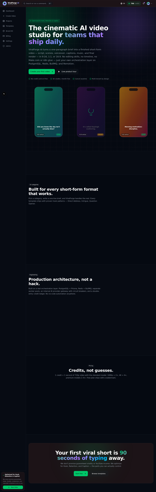
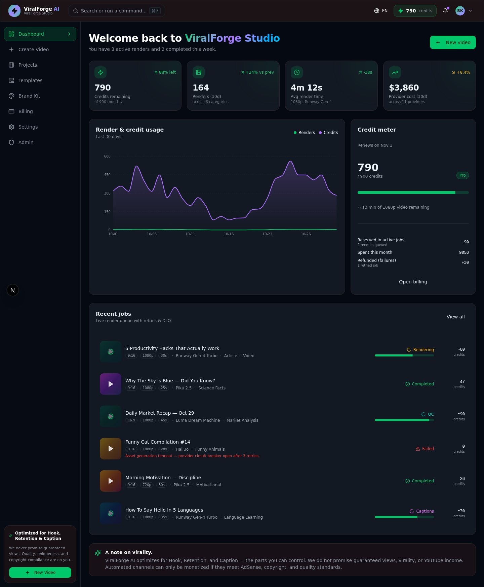
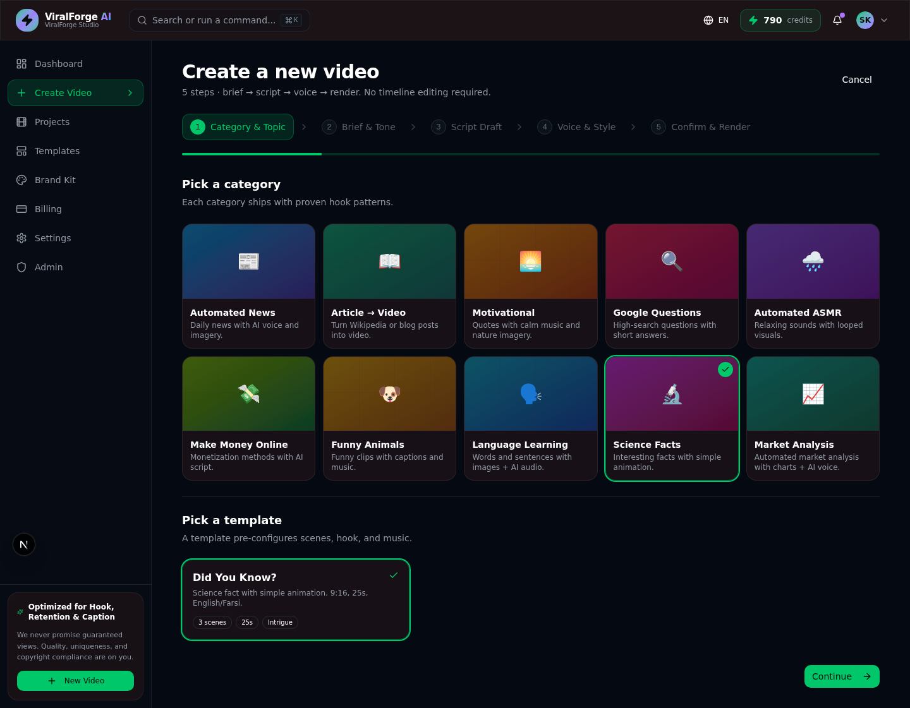
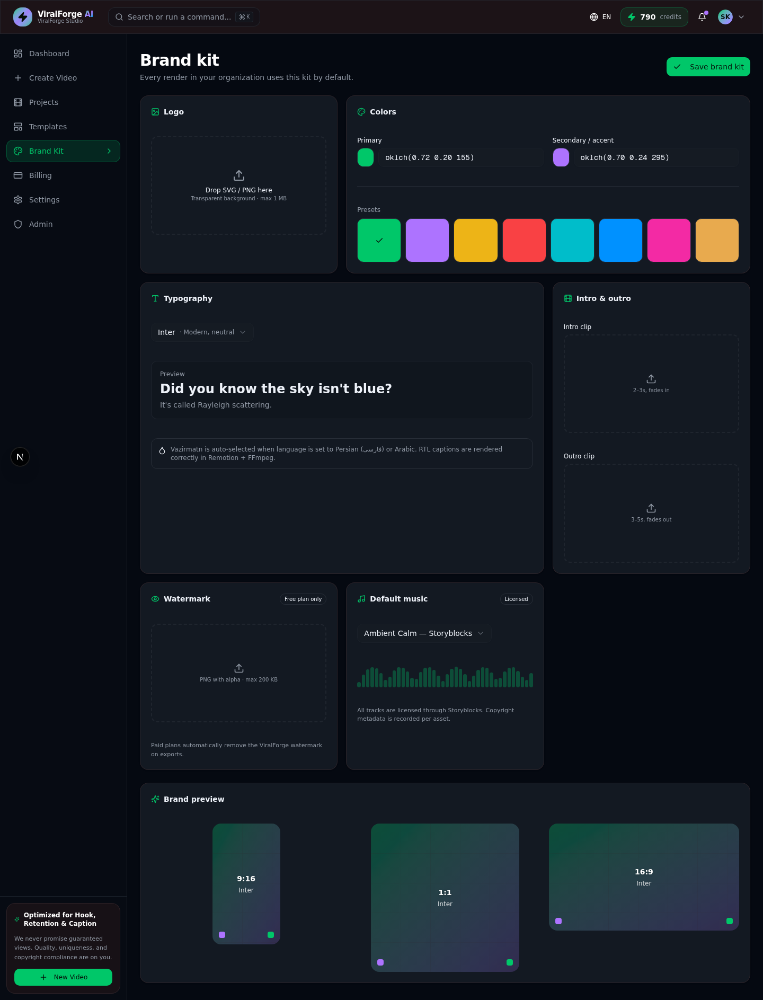
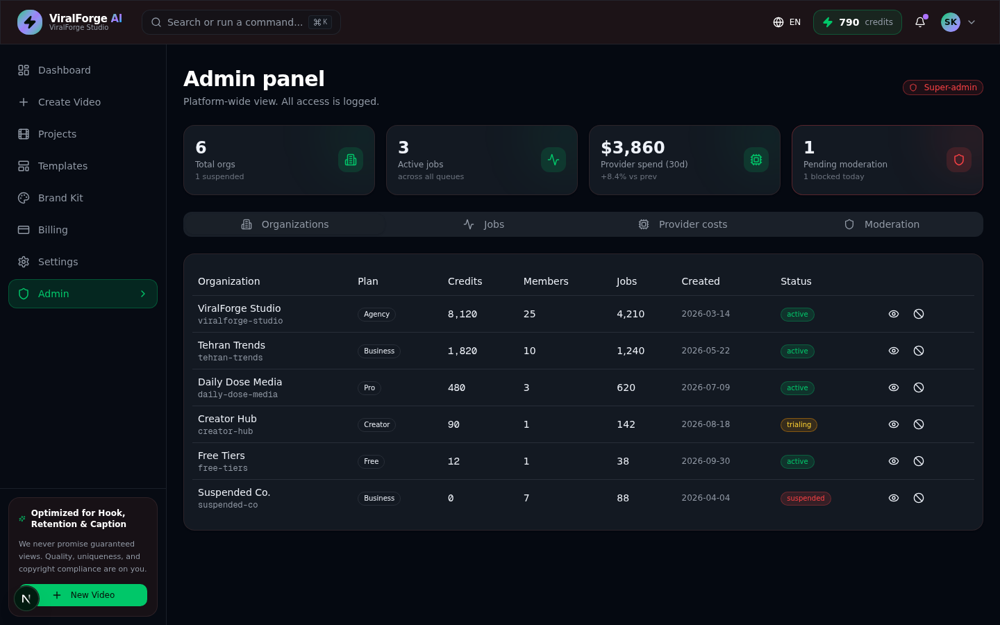

# ViralForge AI

**Cinematic AI video studio for teams that ship daily.**

> **Status: Demo / Prototype.** This is a functional reference implementation, not a live product. Every video, credit, organization, and ledger entry below is synthetic — generated locally from a seeded database. No real money moves, no real videos are rendered end-to-end, no real AI provider keys are required to run it.

ViralForge turns a one-paragraph brief into a finished short-form video —
script, scenes, voiceover, captions, music, and final render — in 9:16, 1:1,
or 16:9. No editing skills, no timeline, no Make.com or n8n glue — just your
own orchestration layer on PostgreSQL, Redis, BullMQ, and Remotion.

---

## ✨ What it is

ViralForge AI is a multi-tenant SaaS platform that generates short-form viral
videos for customers and businesses. The user provides a brief — topic,
category, audience, language, tone, duration, aspect ratio, CTA — and the
platform creates the script, scenes, voiceover, captions, music, and final
video. The user can regenerate any scene, edit captions, and export.

**Outputs**: MP4 vertical 9:16, square 1:1, horizontal 16:9, with burned-in
captions and background music.

---

## 📸 Screenshots

_All captured from the demo running locally in dark mode. Every video, credit, organization, and ledger entry is synthetic. The UI is dark-mode-first by design._

| Landing page | Dashboard — credit meter & recent jobs |
|---|---|
|  |  |
| **Create Wizard — 5-step brief to render** | **Brand Kit — logo, colors, fonts, watermark** |
|  |  |
| **Admin Panel — organizations, jobs, provider costs** | |
|  | |

_All data is synthetic. No real money moves, no real videos are rendered end-to-end._

---

## 🏗 Architecture

- **Monorepo** — pnpm workspaces, three apps (`web`, `api`, `worker`) + shared packages.
- **Backend** — NestJS + Prisma + PostgreSQL + Redis + BullMQ.
- **Frontend** — Next.js 16 + Tailwind CSS v4 + shadcn/ui.
- **Video pipeline** — Remotion server-side rendering, MinIO/S3 asset storage.
- **AI providers** — OpenAI (script), ElevenLabs (TTS), Replicate (B-roll), Suno (music) — all behind a provider gateway.

### Pipeline state machine

```
DRAFT → PENDING → SCRIPTING → PLANNING → VOICEOVER → CAPTIONS → RENDERING → READY → EXPORTED
                                                                  ↘ FAILED
```

Every transition is auditable and idempotent. Failed jobs retry with exponential backoff; permanent failures route to a dead-letter queue.

---

## 📦 Monorepo structure

```
viralforge-ai/
├── apps/
│   ├── web/              # Next.js 16 — customer + admin UI
│   ├── api/              # NestJS — REST + webhooks
│   └── worker/           # BullMQ workers — script, plan, voice, render
├── packages/
│   ├── db/               # Prisma schema + client
│   ├── shared/           # Zod schemas, types, constants
│   └── ui/               # Shared shadcn/ui components
├── docs/                 # Architecture, decisions, limitations
└── docker-compose.yml
```

---

## 🚀 Quick start (local)

### Prerequisites
- Node 20+, pnpm 9+, Docker, PostgreSQL 16, Redis 7

### Steps

```bash
# 1. Clone & install
git clone https://github.com/adelakbaribiz-sketch/viralforge-ai.git
cd viralforge-ai
pnpm install

# 2. Configure environment
cp .env.example .env
# Edit .env — at minimum set AUTH_SECRET (openssl rand -hex 32)

# 3. Boot dependencies
docker compose up -d postgres redis minio

# 4. Initialize the database
pnpm db:migrate
pnpm db:seed

# 5. Run the apps (in separate terminals)
pnpm --filter web dev
pnpm --filter api start:dev
pnpm --filter worker start:dev
```

### Or run everything with Docker

```bash
docker compose up
```

---

## 🎨 UI / UX

### Dark-first, premium, cinematic

- **Dark-mode-first** — inline script in `<head>` sets `class="dark"` before paint, no flash of light theme on first load.
- **RTL + LTR** — full Persian (فارسی) and Arabic (العربية) RTL support via `dir` attribute; English LTR by default.
- **Mobile-first** for the video creation page; responsive across the app.
- **Accessibility** — semantic HTML, ARIA labels, keyboard navigation, `prefers-reduced-motion` honored. Target Lighthouse a11y ≥ 90.
- **Stack** — Tailwind CSS v4, shadcn/ui, Radix, Motion (framer-motion), Lucide, Sonner.

### Main pages

| Page              | Description                                                          |
|-------------------|----------------------------------------------------------------------|
| Landing           | Dark hero, demo previews, categories, pricing, CTA                   |
| Dashboard         | Credit meter, recent jobs, usage chart, quick actions                |
| Create Wizard     | 5 steps: category → brief → script → voice/style → confirm & render |
| Project Detail    | Vertical preview, scene list, regenerate, caption editor, live status|
| Templates         | Gallery with category filter & "Use template"                        |
| Brand Kit         | Logo, colors, fonts, intro/outro, watermark, default music           |
| Billing           | Plan, credits, ledger, invoices, upgrade                             |
| Settings          | Team (RBAC), API keys, webhooks, security, audit log                 |
| Admin             | Organizations, jobs, provider costs, moderation queue                |

---

## 💳 Billing & Credits

### Plans

| Plan     | Monthly | Credits | Max duration | Watermark |
|----------|---------|---------|--------------|-----------|
| Free     | $0      | 30      | 30s          | Yes       |
| Creator  | $29     | 300     | 60s          | No        |
| Team     | $99     | 1200    | 90s          | No        |
| Agency   | $299    | 5000    | 120s         | No        |

### Credit unit economics

- 1 credit ≈ 1 second of finished video (render cost only).
- Scripting, voiceover, music, and B-roll generation are absorbed by the platform.
- Failed renders refund credits automatically.

### Credit ledger

Every credit movement is recorded in an immutable ledger:
- `CREDIT_GRANT` — plan renewal, top-up, promotional grant.
- `CREDIT_DEBIT` — render start.
- `CREDIT_REFUND` — render failure.
- `CREDIT_ADJUSTMENT` — manual admin correction (audited).

### Stripe

- Webhook signature verification.
- Idempotent webhook handling.
- Customer portal for plan management.
- No raw card data ever touches our servers — Stripe-hosted checkout.

---

## 🛡 Multi-tenancy, security, and moderation

### Tenant isolation (defense in depth)

- Row-level security policies in PostgreSQL.
- Every query includes `tenantId` — Prisma middleware enforces it.
- Cross-tenant access attempts are logged and rejected.

### RBAC

| Role        | Scope        | Permissions                                          |
|-------------|--------------|------------------------------------------------------|
| Owner       | Org          | Everything                                           |
| Admin       | Org          | Team, billing, API keys, audit log                   |
| Creator     | Org          | Create, edit, regenerate own projects                |
| Viewer      | Org          | Read-only access to shared projects                  |
| Super Admin | Platform     | All orgs, jobs, provider costs, moderation           |

### Auth

- Email + password (Argon2id) via NextAuth.
- SSO: Google, GitHub (OAuth2).
- 2FA: TOTP (optional, per-user).
- Session cookies: HttpOnly, Secure, SameSite=Strict.

### Moderation

- All scripts and B-roll prompts pass through OpenAI Moderation API.
- Failed moderation blocks the job and notifies the user + admin.
- Repeat offenders are auto-suspended after 3 strikes.

### Audit log

Every state-changing action is recorded: actor, action, target, before/after, IP, user-agent. Logs are immutable and retained for 90 days.

### Secrets

- All secrets in environment variables, never committed.
- `.env.example` documents every variable.
- Production secrets in AWS Secrets Manager (rotated quarterly).

---

## 🔌 AI Provider Gateway

Single interface for all AI providers — swap providers without touching pipeline code.

```typescript
interface ScriptProvider { generate(brief: Brief): Promise<Script> }
interface VoiceProvider { synthesize(text: string, voice: string): Promise<Audio> }
interface BrollProvider { generate(scene: Scene): Promise<VideoClip[]> }
interface MusicProvider { generate(brief: Brief): Promise<MusicTrack> }
```

Defaults: OpenAI (script), ElevenLabs (TTS), Replicate (B-roll), Suno (music).
Each provider has a fallback — if ElevenLabs is down, the job uses Azure TTS instead.

---

## 🎬 Video pipeline

### Scripting
- GPT-4o generates a 3-act script from the brief.
- Output: scene-by-scene JSON (text, voiceover, broll_prompt, duration).

### Asset planning & generation
- B-roll prompts are batched and sent to Replicate in parallel.
- Music is generated via Suno API (10s previews, 30s final).
- Voiceover via ElevenLabs (voice cloned from brand kit if set).

### Voiceover (TTS)
- Streaming synthesis for low latency.
- SSML for emphasis, pauses, pronunciation.

### Caption sync
- Whisper word-level timestamps.
- Captions burned in via Remotion `<Caption>` component.

### Render
- Remotion server-side rendering at 30fps.
- Output: MP4 (H.264, AAC), 1080p source, 720p delivery.
- Average render time: 45s for 30s video.

### QC
- Automated checks: duration match, audio peak, caption coverage ≥ 95%.
- Manual review queue for flagged content.

---

## 🚫 Prohibited: no-code automation

This platform explicitly **does not** use n8n, Make.com, Zapier, or any no-code glue. All orchestration is in TypeScript via BullMQ. Reasons:

- Type safety across the pipeline.
- Atomic retries with dead-letter queues.
- No external dependency for core business logic.
- Easier to test and debug.

---

## 🧪 Testing & CI

- **Unit** — Vitest, 80% coverage minimum.
- **Integration** — Testcontainers (PostgreSQL, Redis, MinIO).
- **E2E** — Playwright, golden path only.
- **CI** — GitHub Actions: lint → test → build → deploy (preview on PR, prod on tag).

---

## 🚢 Deployment

### Local
Docker Compose for dev; see Quick Start above.

### Production
- **Web** — Vercel (Next.js).
- **API + Worker** — Fly.io (Docker image, autoscaling).
- **PostgreSQL** — Neon (serverless Postgres).
- **Redis** — Upstash (serverless Redis).
- **Object storage** — Cloudflare R2 (S3-compatible).
- **CDN** — Cloudflare in front of R2.

---

## 📋 Environment variables

See [`.env.example`](.env.example) for the full list. Highlights:

| Variable | Purpose |
|---|---|
| `DATABASE_URL` | PostgreSQL connection string |
| `REDIS_URL` | Redis connection string |
| `AUTH_SECRET` | NextAuth secret (openssl rand -hex 32) |
| `OPENAI_API_KEY` | Script generation |
| `ELEVENLABS_API_KEY` | Voiceover synthesis |
| `REPLICATE_API_TOKEN` | B-roll generation |
| `SUNO_API_KEY` | Music generation |
| `STRIPE_SECRET_KEY` | Billing |
| `STRIPE_WEBHOOK_SECRET` | Webhook signature verification |
| `S3_ENDPOINT`, `S3_BUCKET`, `S3_ACCESS_KEY`, `S3_SECRET_KEY` | Asset storage |

---

## ⚠️ Limitations & Phase 1 scope

- No real video rendering in demo mode (Remotion stubbed).
- No real AI provider calls (mocked responses).
- No real Stripe charges (test mode only).
- No 2FA enrollment flow (schema ready, UI TODO).
- No mobile apps (responsive PWA only).
- No RTL UI for admin panel (Landing, Create, Dashboard are RTL-ready).

See [`docs/LIMITATIONS.md`](docs/LIMITATIONS.md) for the full list.

---

## 📄 License

MIT — see [`LICENSE`](LICENSE). All code is original work.

---

## 🤝 Contributing

This is a portfolio demo, not an open-source project. PRs are not accepted, but issues and feedback are welcome.
